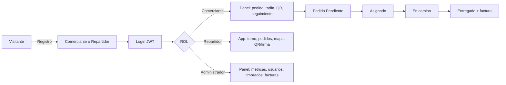

# I.1 — Gestión ágil y planificación (Sprint 1 y 2)

## 1.1 Equipo y roles Scrum

| Rol | Integrante | Responsabilidad |
|---|---|---|
| Product Owner | `[COMPLETAR]` | Prioriza el backlog por valor de negocio y valida criterios de aceptación |
| Scrum Master | `[COMPLETAR]` | Facilita ceremonias, elimina impedimentos, cuida el proceso |
| Development Team | `[COMPLETAR]` (mínimo 2) | Diseño, implementación, pruebas y despliegue |
| Stakeholder / PO del negocio | `[COMPLETAR]` | Comercios y repartidores piloto |

> El historial de Git registra un único autor (`mathiasparedes202-droid`). Si el
> equipo tuvo más integrantes, completar la tabla y reflejar sus aportes en el
> repositorio (commits/PRs), porque la rúbrica revisa el historial.

## 1.2 Calendario de sprints

Ventana reconstruida a partir de las fechas reales de los commits (ajustar a
las fechas oficiales del curso):

| Sprint | Objetivo | Ventana (Git) | Entregable |
|---|---|---|---|
| 1 | Base de autenticación, roles y modelo de datos | 2026-09-01 → 09-07 | Login/registro, esquema `ecoruta_db` |
| 2 | Pedido de reparto, tarifa ecológica y panel del comercio | 2026-10-08 → 10-13 | Alta de pedidos, tarifas, QR de pedido |
| 3 | App del repartidor, turnos, trazabilidad y métricas | 2026-10-14 → 10-20 | App Capacitor + panel de métricas |
| 4 | Timbrado y facturación electrónica pre-fiscal | 2026-10-21 → 10-29 | KuDE/PDF, QR, auditoría fiscal |
| 5 | Offline, clientes, DevOps, documentación y hardening | 2026-10-29 → 11-20 | Sync, CSV, docs, cierre de sesión |

## 1.3 Product Backlog

Prioridad MoSCoW (M = Must, S = Should, C = Could). Puntos en escala Fibonacci.
Estado: ✅ implementado, 🟡 parcial, 🔴 pendiente.

| ID | Historia de usuario | Prioridad | Puntos | Sprint | Estado |
|---|---|---|---|---|---|
| HU-01 | Como visitante quiero registrarme como comerciante o repartidor para operar en la plataforma | M | 5 | 1 | ✅ |
| HU-02 | Como usuario quiero iniciar y cerrar sesión de forma segura | M | 3 | 1 | ✅ |
| HU-03 | Como usuario quiero recuperar mi contraseña por correo | S | 3 | 1 | ✅ |
| HU-04 | Como comerciante quiero solicitar un reparto indicando origen, destino, peso y dimensiones, y ver la tarifa antes de confirmar | M | 8 | 2 | ✅ |
| HU-05 | Como administrador quiero asignar pedidos a repartidores disponibles | M | 5 | 2 | ✅ |
| HU-06 | Como repartidor quiero iniciar, pausar y finalizar mi turno desde el teléfono | M | 5 | 3 | ✅ |
| HU-07 | Como repartidor quiero actualizar el estado del pedido (En camino / Entregado) con constancia | M | 5 | 3 | ✅ |
| HU-08 | Como repartidor quiero confirmar la entrega escaneando el QR del pedido o registrando la firma del destinatario | M | 8 | 3 | 🟡 (firma = nombre, no trazo) |
| HU-09 | Como comerciante quiero seguir el estado de mis pedidos y recibir avisos | S | 5 | 3 | ✅ |
| HU-10 | Como administrador quiero ver métricas diarias de entregas, ingresos y CO₂ evitado | S | 5 | 3 | ✅ |
| HU-11 | Como administrador quiero registrar timbrados con vigencia y rango de folios, y que el sistema bloquee la emisión si no hay timbrado válido | M | 8 | 4 | ✅ |
| HU-12 | Como sistema quiero emitir automáticamente la factura al entregar el pedido, con IVA discriminado y folio correlativo | M | 8 | 4 | ✅ |
| HU-13 | Como usuario quiero ver e imprimir el KuDE/PDF con QR que reabra la factura | M | 5 | 4 | ✅ |
| HU-14 | Como administrador quiero anular una factura con motivo y auditoría | S | 3 | 4 | ✅ |
| HU-15 | Como administrador quiero consultar el historial de facturas con filtros y descargas | S | 3 | 4 | ✅ |
| HU-16 | Como usuario quiero que mi sesión se cierre sola cuando el token vence | M | 3 | 5 | ✅ |
| HU-17 | Como operador quiero seguir operando sin internet y sincronizar al volver | S | 8 | 5 | ✅ |
| HU-18 | Como administrador quiero gestionar clientes y cargarlos masivamente por CSV | C | 5 | 5 | ✅ |
| HU-19 | Como comercio quiero registrar pagos en efectivo, transferencia o mixto, con vuelto | M | 5 | 2 | ✅ |
| HU-20 | Como administrador quiero gestionar usuarios, roles y estado de cuenta | S | 3 | 5 | ✅ |

**Total:** 103 puntos. Distribución por sprint: S1 11, S2 18, S3 28, S4 27, S5 19.

### Criterios INVEST

| HU | I | N | V | E | S | T | Observación |
|---|---|---|---|---|---|---|---|
| HU-01 | ✓ | ✓ | ✓ | ✓ | ✓ | ✓ | Validaciones de rol, correo, contraseña y vehículo |
| HU-04 | ✓ | ✓ | ✓ | ✓ | ✓ | ✓ | Tarifa calculada en backend y mostrada antes de confirmar |
| HU-08 | ✓ | ✓ | ✓ | ✓ | ✓ | ✓ | QR validado contra el `id_pedido` |
| HU-11 | ✓ | ✓ | ✓ | ✓ | ✓ | ✓ | Bloqueo verificable con timbrado vencido/agotado |
| HU-12 | ✓ | ✓ | ✓ | ✓ | ✓ | ✓ | Idempotente: un pedido = una factura |
| HU-16 | ✓ | ✓ | ✓ | ✓ | ✓ | ✓ | Prueba con token de `exp` pasado |

### Criterios de aceptación (formato Gherkin)

**HU-04 — Solicitud de reparto**

```gherkin
Escenario: Alta de pedido con tarifa ecológica
  Dado un comerciante autenticado con sesión vigente
  Cuando envía origen, destino, peso, dimensiones y método de pago
  Entonces el sistema valida peso (0,1–50 kg) y distancia
  Y calcula tarifa = base + km*2.500 + kg*1.500 + dm³*250 (redondeada a Gs)
  Y calcula CO₂ evitado = km * 0,180 kg
  Y devuelve el pedido en estado "Pendiente" con su QR
```

**HU-08 — Confirmación de entrega**

```gherkin
Escenario: QR incorrecto
  Dado un repartidor con el pedido #123 asignado
  Cuando escanea un QR cuyo payload no corresponde al pedido #123
  Entonces la app muestra "El código QR no pertenece al pedido #123"
  Y no permite confirmar la entrega

Escenario: Confirmación válida
  Dado el QR válido del pedido #123
  Cuando el repartidor confirma
  Entonces el pedido pasa a "Entregado" con fecha_entrega
  Y se registra el detalle de confirmación (QR o firma)
  Y se emite la factura automática si hay timbrado vigente
```

**HU-11 — Bloqueo por timbrado**

```gherkin
Escenario: Timbrado vencido
  Dado que no existe timbrado activo con fecha_fin >= hoy y folios disponibles
  Cuando se intenta emitir una factura
  Entonces el sistema responde 422 "No hay timbrado vigente"
  Y no consume folio ni crea la factura

Escenario: Folios agotados
  Dado un timbrado con secuencia_actual = nro_fin
  Entonces el timbrado no se considera vigente y la emisión se bloquea
```

**HU-12 — Cálculo fiscal**

```gherkin
Escenario: Precio con IVA incluido
  Dado un servicio de Gs 7.000 con IVA 10 %
  Entonces la gravada es 6.364 y el IVA es 636
  Y gravada + IVA = 7.000 exacto (guaraníes enteros)

Escenario: Factura de Gs 1.046.204
  Entonces la gravada es 951.095, el IVA es 95.109 y el total 1.046.204
  Y la liquidación del IVA muestra 95.109
```

**HU-16 — Vencimiento de sesión**

```gherkin
Escenario: Token vencido al abrir la app
  Dado un token con exp anterior a ahora
  Cuando se carga la aplicación
  Entonces se borran token y usuario del almacenamiento
  Y se muestra la pantalla de login

Escenario: 401 del backend
  Dado un usuario con sesión iniciada
  Cuando una llamada responde 401
  Entonces la sesión se cierra y se redirige al login
```

## 1.4 Prototipado UI/UX

### Flujos implementados



### Pantallas y componentes reales

| Flujo | Archivo | Qué muestra |
|---|---|---|
| Login / registro / recuperación | `frontend/src/components/AuthPanel.jsx` | Formularios, validaciones, cambio forzado de contraseña |
| Panel comerciante | `frontend/src/pages/MerchantDashboard.jsx`, `MisPedidos.jsx` | Alta de pedido, mapa, tarifa, QR, estados, pago |
| Panel administrador | `frontend/src/pages/AdminOverview.jsx`, `AdminOrders.jsx`, `AdminUsers.jsx` | Métricas, asignación, cobros, usuarios |
| Facturación | `frontend/src/pages/FacturasPage.jsx`, `TimbradosPage.jsx` | Historial, KuDE, PDF, anulación, timbrados |
| App repartidor | `EcoRuta-app/src/RepartidorDashboard.tsx` y `components/repartidor/*` | Turno, pedidos, mapa, escaneo QR, confirmación |
| Clientes | `frontend/src/pages/ClientesPage.jsx` | ABM y carga CSV |

### Principios de diseño aplicados

- **Mobile-first** en la app del repartidor: navegación inferior, botones
  grandes, alto contraste y funcionamiento sin conexión.
- **Prevención de errores**: la tarifa se calcula en el servidor; el QR se
  valida contra el pedido; el pago en efectivo exige monto recibido y muestra
  el vuelto; el timbrado se bloquea antes de consumir folios.
- **Feedback inmediato**: notificaciones internas, toasts y estados de carga.
- **Accesibilidad**: etiquetas `aria-label`, roles y foco visible en los
  controles principales.

> Enlaces o capturas de Figma: `[COMPLETAR]`. Se recomienda subir las capturas
> a `docs/assets/ux/` y enlazarlas aquí para que la evidencia no dependa de un
> servicio externo.

## 1.5 Evidencias del marco Scrum

### Ceremonias y cadencia

| Ceremonia | Cuándo | Duración | Evidencia a adjuntar |
|---|---|---|---|
| Sprint Planning | Inicio de sprint | 1 h | Acta + backlog comprometido (`[COMPLETAR]`) |
| Daily Standup | Diario | 15 min | Bitácora o tablero (`[COMPLETAR]`) |
| Sprint Review | Fin de sprint | 45 min | Demo + feedback del PO (`[COMPLETAR]`) |
| Retrospectiva | Fin de sprint | 30 min | Acuerdos de mejora (`[COMPLETAR]`) |
| Refinamiento | Mitad de sprint | 30 min | Ajustes al backlog (`[COMPLETAR]`) |

### Plantilla de acta (copiar por ceremonia)

```markdown
### Acta — <Ceremonia> — Sprint <N>
- Fecha / hora:
- Participantes (rol):
- Objetivo:
- Temas tratados:
  1.
  2.
- Decisiones y acuerdos (responsable / fecha):
  - [ ]
- Impedimentos detectados:
- Evidencia (enlace a tablero, grabación o captura):
```

### Trazabilidad real disponible

- **Commits atómicos** con mensajes descriptivos en `main` (ver
  [`05-devops-metricas-sprint-5.md`](05-devops-metricas-sprint-5.md)).
- **Workflow de CI** `React Doctor` en `.github/workflows/react-doctor.yml`
  (analiza PRs y `main`).
- **Planilla de métricas** con velocity y burndown en
  `docs/metricas/EcoRuta-Velocity.xlsx`.

## 1.6 Riesgos y supuestos del backlog

| Riesgo | Impacto | Mitigación |
|---|---|---|
| Un solo desarrollador ⇒ poca revisión cruzada | Medio | PRs con checklist y CI; documentar decisiones |
| Conectividad intermitente en la zona de reparto | Alto | Cola offline + idempotencia (`sync_uuid`) |
| Datos fiscales históricos con decimales | Medio | Normalización a guaraníes enteros en cálculo y presentación |
| Dependencia de Render (cold start) | Medio | Reintento antes de degradar a local + app de escritorio |
| Falta de certificado SET para SIFEN | Alto | Alcance pre-fiscal declarado + plan de fase 2 |
