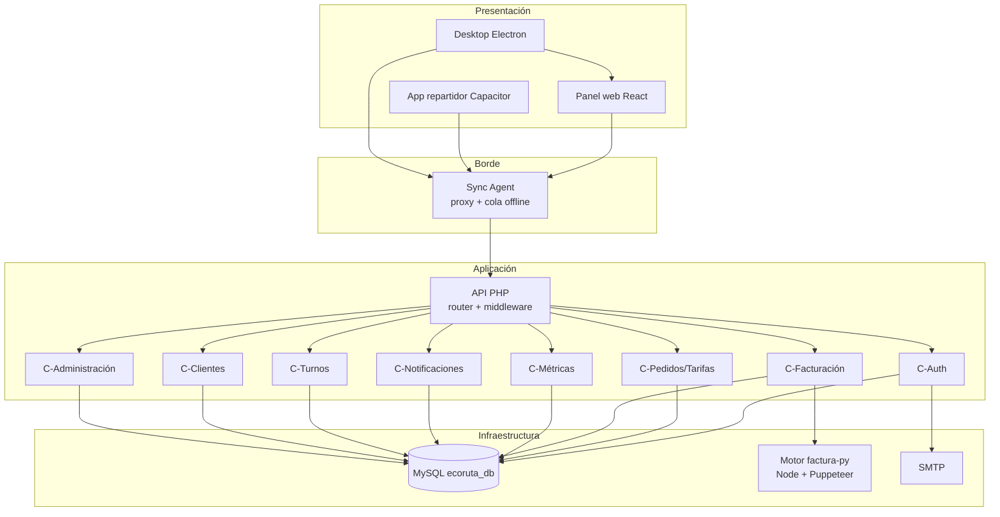
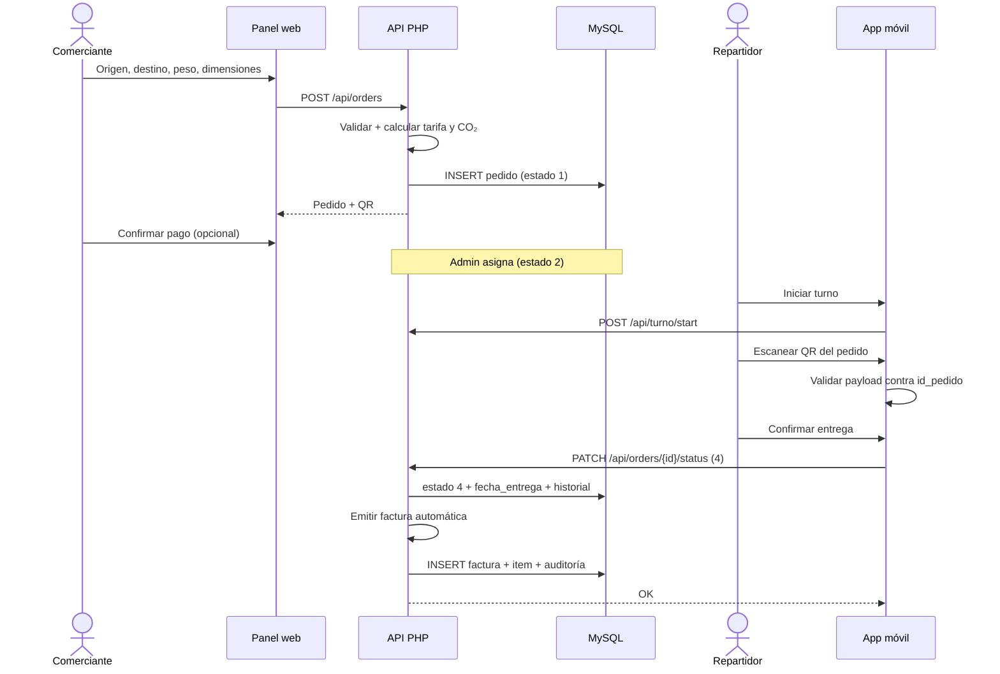
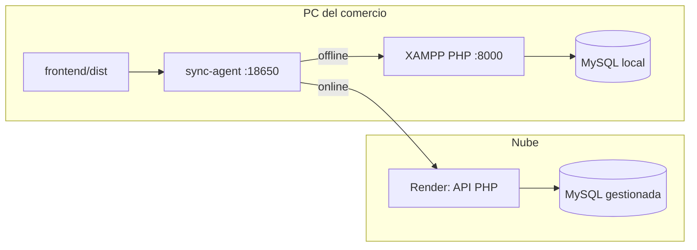

# I.2 — Diseño arquitectónico CBSE

## 2.1 Vista general

EcoRuta se compone de **componentes lógicos independientes** con interfaces
explícitas. La composición es **jerárquica** (el panel web y la app móvil
consumen la API; la API orquesta servicios de dominio) y **aditiva** en el
borde (el `sync-agent` y el `desktop-app` agregan tolerancia a fallos sin
modificar los componentes de negocio).



## 2.2 Componentes y contratos

### C-Auth — Autenticación y sesión

| Aspecto | Detalle |
|---|---|
| Responsabilidad | Registro, login, recuperación de contraseña, emisión/validación de JWT, cierre por vencimiento |
| Archivos | `backend/src/services/auth_service.php`, `account_service.php`, `src/middleware/auth.php`, `src/config/jwt.php` |
| **Proporciona** | `POST /api/auth/register`, `POST /api/auth/login`, `POST /api/auth/forgot-password`, `POST /api/auth/reset-password`, `GET/PATCH /api/me`, `POST /api/me/password` |
| **Requiere** | MySQL (`usuarios`, `roles`, `comercios`, `repartidores`), SMTP (PHPMailer), reloj del sistema |

Contrato principal:

```json
POST /api/auth/login
{ "correo": "usuario@dominio.com", "contraseña": "********" }

200 OK
{
  "token": "<JWT HS256>",
  "user": { "id_usuario": 11, "id_rol": 3, "nombre_completo": "...", "debe_cambiar_contraseña": 0 }
}
401 { "message": "Correo o contraseña incorrectos" }
```

Reglas del token: `HS256`, claims `iss`, `iat`, `exp` (por defecto 3600 s),
`sub`, `rol`. La validación usa un **secreto único** (`src/config/jwt.php`) para
evitar el fallo histórico de "token válido rechazado". En el cliente, `exp` se
decodifica y se programa el cierre de sesión; cualquier `401` también limpia la
sesión (`frontend/src/services/authSession.js`).

### C-Pedidos / Tarifas

| Aspecto | Detalle |
|---|---|
| Responsabilidad | Alta, edición, asignación, cancelación y cambio de estado de pedidos; cálculo de tarifa y CO₂ |
| Archivos | `backend/src/services/orders_service.php`, `routes_service.php`, `geografia.php` |
| **Proporciona** | `GET/POST /api/orders`, `PATCH /api/orders/{id}`, `/status`, `/assign`, `/cancel`, `/pago`, `GET /api/routes` |
| **Requiere** | C-Auth (identidad/rol), MySQL (`pedidos`, `historial_estados`, `clientes`), C-Notificaciones, C-Facturación (emisión automática al entregar) |

Invariantes:

- Peso válido `0 < kg ≤ 50`; distancia `≥ 0`; destino dentro de Paraguay.
- `tarifa = round(base + km·2.500 + kg·1.500 + dm³·250)`, con
  `dm³ = alto·ancho·largo / 1000`.
- `co2_ahorrado_kg = round(km · 0,180, 4)` (o el valor explícito del cliente).
- Estados: `1 Pendiente → 2 Asignado → 3 En Camino → 4 Entregado`; `5 Cancelado`
  con motivo obligatorio. La cancelación no se hace por cambio de estado.
- Un pedido entregado y pagado **no** se revierte a impago.

### C-Facturación (pre-fiscal)

| Aspecto | Detalle |
|---|---|
| Responsabilidad | Timbrados, folios, emisión, anulación, auditoría, KuDE/PDF, CDC interno y QR |
| Archivos | `backend/src/services/facturacion_service.php`, `src/controllers/facturacion_controller.php`, `factura-py/` |
| **Proporciona** | `GET/POST/PUT /api/timbrados`, `POST /api/pedidos/{id}/factura`, `GET /api/facturas`, `/kude`, `/html`, `/pdf`, `POST /api/facturas/{id}/anular` |
| **Requiere** | C-Pedidos (datos del servicio), MySQL (`timbrados`, `facturas`, `factura_items`, `factura_auditoria`), motor Node/Puppeteer, `APP_URL` |

Contrato de emisión:

```json
POST /api/pedidos/270056/factura
{ "receptor": { "ruc": "1234567", "razon_social": "María Rodríguez", "direccion": "..." } }

201 Created
{
  "id_factura": 30001,
  "numero": "001-001-0000032",
  "total": 1046204,
  "iva_10": 95109,
  "repetida": false,
  "message": "Factura 001-001-0000032 emitida"
}
```

Errores: `422` sin timbrado vigente o sin tarifa; `409`/`200 repetida` si el
pedido ya tenía factura (idempotencia por `UNIQUE(id_pedido)`).

### C-Métricas

| Aspecto | Detalle |
|---|---|
| Responsabilidad | Serie diaria de pedidos, entregas, ingresos, CO₂ y tiempos; recaudación por método; ranking de repartidores |
| Archivos | `backend/src/services/metrics_service.php`, `frontend/src/pages/AdminOverview.jsx` |
| **Proporciona** | `GET /api/metrics?desde=YYYY-MM-DD&hasta=YYYY-MM-DD` |
| **Requiere** | MySQL (`pedidos`, `metricas_diarias`), C-Auth (rol admin) |

Garantías: rango por defecto de 7 días, tope de 93 días, fechas validadas,
relleno de días sin movimiento y uso de `CURDATE()` de MySQL para evitar
desfases de zona horaria.

### C-Notificaciones

| Aspecto | Detalle |
|---|---|
| Responsabilidad | Avisos internos por usuario/rol ante asignación, entrega, pago o cancelación |
| Archivos | `backend/src/services/notificaciones_service.php` |
| **Proporciona** | `GET /api/notificaciones`, `/no-leidas`, `POST /leer-todas`, `PATCH /{id}/leida` |
| **Requiere** | MySQL (`notificaciones`), C-Auth |

### C-Clientes

| Aspecto | Detalle |
|---|---|
| Responsabilidad | ABM de clientes del comercio y carga masiva CSV con validación |
| Archivos | `backend/src/services/clientes_service.php`, `frontend/src/lib/clientesCsv.js` |
| **Proporciona** | `GET/POST /api/clientes`, `PATCH/DELETE /api/clientes/{id}`, `POST /api/clientes/import` |
| **Requiere** | MySQL (`clientes`), C-Auth |

Contrato CSV: columnas obligatorias `nombre;direccion;lat;lng`; opcionales
`ruc_ci;telefono;referencia`. Validaciones: nombre ≥ 2, RUC/CI con formato
`^\d{5,8}$` o `^\d{8}-\d$`, teléfono `^\+?[0-9\s-]{7,20}$`, coordenadas
numéricas.

### C-Sync / Offline (borde)

| Aspecto | Detalle |
|---|---|
| Responsabilidad | Proxy hacia la web con degradación a local, cola `outbox`, replay idempotente y pull incremental |
| Archivos | `sync-agent/src/proxy.js`, `webClient.js`, `sync-connector/`, `sync-hub/`, `backend/src/services/sync_service.php` |
| **Proporciona** | `http://localhost:18650` (API), panel de estado, `GET /api/sync/pull`, `POST /api/sync/push` |
| **Requiere** | `SYNC_API_KEY` compartida, MySQL local y web, ambos backends desplegados |

Garantías: `sync_uuid` en origen + `UNIQUE` en base + búsqueda previa ⇒ no hay
pedidos duplicados; un `pagado=1` nunca se revierte por un reintento; ante cold
start de Render se reintenta la web antes de degradar a local.

### C-Administración

| Aspecto | Detalle |
|---|---|
| Responsabilidad | Usuarios, roles, estado de cuenta, repartidores disponibles |
| Archivos | `backend/src/services/admin_service.php`, `frontend/src/pages/AdminUsers.jsx` |
| **Proporciona** | `GET/POST /api/admin/users`, `PATCH /api/admin/users/{id}`, `GET /api/admin/repartidores` |
| **Requiere** | C-Auth (rol 3), MySQL |

## 2.3 Diagramas de secuencia

### Alta y entrega de un pedido



### Emisión de factura y KuDE

```mermaid
sequenceDiagram
  participant API as API PHP
  participant FS as Facturación
  participant DB as MySQL
  participant N as factura-py (Node)
  participant P as Puppeteer

  API->>FS: emitirFacturaPorPedido(id)
  FS->>DB: Buscar timbrado vigente (FOR UPDATE)
  alt Sin timbrado / folios agotados
    FS-->>API: 422 (bloqueo)
  else Timbrado válido
    FS->>FS: IVA = round(total/11), gravada = total - IVA
    FS->>DB: INSERT factura + item + auditoría; secuencia_actual++
    FS->>DB: UPDATE qr_texto = URL pública
  end
  API->>N: generate-factura --mode pdf --input modelo.json
  N->>P: Render HTML (domcontentloaded + esperas acotadas)
  P-->>N: PDF
  N-->>API: archivo
```

## 2.4 Composición, adaptadores y middleware

### Mecanismo de composición

1. **Jerárquico** dentro de la API: el router (`backend/index.php`) delega en
   controladores, que orquestan servicios de dominio. Los servicios no conocen
   HTTP.
2. **Aditivo** en el borde: `sync-agent` envuelve la API (no la modifica) y
   agrega reintentos, cola y failover. `desktop-app` envuelve el sistema
   completo para el usuario final.
3. **Adaptadores** para dependencias externas:
   - Motor de PDF: proceso Node/Puppeteer invocado por CLI, con fallback HTML
     en PHP si no hay Chromium.
   - QR: `qrcode` (Node/web) y `jsqr` (escaneo móvil).
   - Correo: PHPMailer sobre SMTP.
   - Mapas: Leaflet + `leaflet-control-geocoder`.

### Servicios transversales

| Servicio | Implementación | Archivo |
|---|---|---|
| Seguridad | JWT HS256, `requireAuth`/`optionalAuth`, roles por claim | `src/middleware/auth.php` |
| CORS | Orígenes permitidos y preflight | `src/middleware/cors.php`, `src/config/cors.php` |
| Errores | Manejador global que devuelve JSON con archivo/línea | `backend/index.php` |
| Validación | `requireFields` y validaciones de dominio | `src/middleware/request.php` |
| Persistencia | PDO + transacciones + `FOR UPDATE` | `src/config/database.php` |
| Idempotencia | `sync_uuid` + `UNIQUE` + búsqueda previa | migraciones 44/45, `sync_service.php` |
| Observabilidad | `/api/health`, `/api/sync/health`, panel del agente | `backend/index.php`, `sync-agent` |

## 2.5 Incompatibilidades resueltas (decisiones reales)

| Incompatibilidad | Síntoma | Solución aplicada |
|---|---|---|
| Local vs. web con bases distintas | Pedidos que "desaparecen" | Agente intermediario con pull/push incremental e idempotencia |
| Render cold start | "Factura no encontrada" al primer intento | Reintento acotado antes de degradar a local |
| Chromium ausente en el servidor | PDF no disponible | Detección real del error + fallback HTML + mensaje claro |
| `networkidle0` colgaba el render | Timeout de 30 s | `domcontentloaded` + esperas acotadas de imágenes/fuentes |
| Precios con IVA incluido | IVA sumado dos veces | Extracción `/11` y `/21`, gravada = bruto − IVA |
| Datos históricos con decimales | PDF mostraba 951.094,55 | Normalización a guaraníes enteros en cálculo, payload y plantilla |
| Tokens emitidos/validados con secretos distintos | 401 con token válido | Secreto único en `src/config/jwt.php` |
| Sesión que quedaba abierta | Usuario "fantasma" tras expirar | Temporizador de `exp` + cierre ante `401` |

## 2.6 Contratos y códigos de error

| Código | Uso |
|---|---|
| `200` | Operación exitosa |
| `201` | Recurso creado (pedido, factura, usuario) |
| `400` | Datos inválidos o enlace de recuperación vencido |
| `401` | Sin token, token vencido o inválido |
| `403` | Rol sin permiso sobre el recurso |
| `404` | Recurso inexistente |
| `409` | Conflicto de estado (p. ej. pedido ya facturado) |
| `422` | Regla de negocio incumplida (timbrado, peso, pago, folios) |
| `500` | Error interno (se registra y se devuelve mensaje acotado) |
| `501` | Capacidad no disponible en el servidor (PDF sin Chromium) |
| `503` | Base de datos no disponible |

## 2.7 Despliegue



- **Local:** XAMPP (Apache/PHP 8.2 + MySQL), `frontend` servido por Vite o
  build estático, agente en `:18650`.
- **Nube:** Render con Docker (`Dockerfile`), `FACTURA_PY_PATH` para el motor de
  comprobantes, variables `APP_URL`, `JWT_SECRET`, `SYNC_API_KEY`, SMTP.
- **Móvil:** Capacitor 6; `VITE_API_URL` apunta al agente o a la API web.
