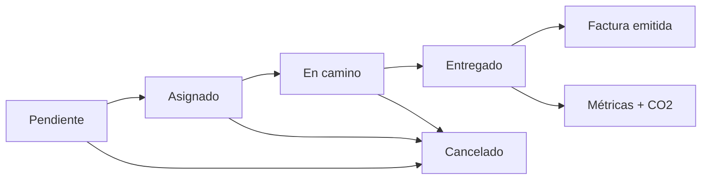

# I.3 — MVP y módulos funcionales (Sprint 3)

## 3.1 Alcance del MVP

El MVP cubre el ciclo completo de una entrega: el comercio solicita el reparto,
el administrador lo asigna, el repartidor lo ejecuta desde el teléfono y el
sistema registra la entrega, el cobro, las métricas y la factura.



## 3.2 Módulo base y repartidor

**Tecnología:** React 18 + TypeScript + Vite + Capacitor 6 (Android), con
`jsqr` para lectura de QR y `qrcode` para generación.

| Pantalla / componente | Archivo | Función |
|---|---|---|
| Login | `src/Login.tsx` | Autenticación contra la API |
| Tablero | `src/RepartidorDashboard.tsx` | Turno, pedidos del día, navegación |
| Mapa | `src/RepartidorMap.tsx` | Ruta y puntos de entrega (Leaflet) |
| Control de turno | `components/repartidor/TurnControl.tsx` | Iniciar, pausar, reanudar, finalizar |
| Lista de pedidos | `OrderList.tsx`, `OrderCard.tsx` | Estado, dirección, tarifa, acciones |
| Escaneo QR | `ScanCam.tsx` + `lib/qr.ts` | Cámara o imagen, validación del pedido |
| Confirmación | `DeliveryConfirmationModal.tsx` | QR o firma + nota + cobro en efectivo |
| Notificaciones | `NotificationsBell.tsx` | Avisos no leídos |
| Perfil | `ProfileView.tsx` | Datos y cierre de sesión |
| Cancelación | `CancelOrderModal.tsx` | Motivo obligatorio |
| Estadísticas | `CourierStats.tsx` | Entregas y CO₂ del repartidor |

### Ciclo de vida del turno

| Transición | Endpoint | Regla |
|---|---|---|
| Iniciar | `POST /api/turno/start` | No puede haber otro turno abierto |
| Pausar | `PATCH /api/turno/pause` | Sólo si está `activo`; guarda `fecha_pausa` |
| Reanudar | `PATCH /api/turno/resume` | Sólo si está `pausado`; acumula `tiempo_pausado_seg` |
| Finalizar | `PATCH /api/turno/finish` | Calcula tiempo efectivo y deja `disponible = 0` |

Estados persistidos: `activo`, `pausado`, `finalizado`.

### Operación sin conexión

La app implementa un **nodo mula** con `localStorage`:

- `ecoruta_mis_pedidos_v1`: último listado de pedidos asignados (caché).
- `ecoruta_outbox_v1`: cola FIFO de operaciones (`estado`, `pago`, `cancel`)
  con `sync_uuid`, intentos y estado (`pending` / `conflict`).

Reglas de la cola:

1. Sin red, la operación se aplica localmente y se encola.
2. Al recuperar señal se sube en orden; un `401` detiene todo (sesión vencida).
3. Un rechazo de negocio (`422`) pasa a **conflicto visible**, no se reintenta
   eternamente.
4. Un `pagado=1` confirmado en el servidor no se revierte por un reintento.

Pruebas automatizadas (`vitest`): `src/lib/offlineSync.test.ts` y
`src/lib/qr.test.ts` (caché sin red, orden FIFO, conflicto 422, corte por 401,
generación/lectura/validación de QR).

## 3.3 Trazabilidad de estados

### Reglas de transición

| Desde | Hacia | Quién | Endpoint | Efectos |
|---|---|---|---|---|
| 1 Pendiente | 2 Asignado | Admin | `PATCH /api/orders/{id}/assign` | `id_repartidor`, `fecha_asignacion`, notificación al repartidor |
| 2 Asignado | 3 En camino | Repartidor dueño / Admin | `PATCH /api/orders/{id}/status` | Historial + notificación al comercio |
| 3 En camino | 4 Entregado | Repartidor dueño / Admin | idem | `fecha_entrega`, historial, notificación y **factura automática** |
| 1/2/3 | 5 Cancelado | Comercio dueño / Admin | `PATCH /api/orders/{id}/cancel` | Motivo obligatorio, `fecha_cancelacion`, avisos |
| 5 Cancelado | 1 Pendiente | Comercio dueño / Admin | `PATCH /api/orders/{id}` con `relanzar` | Sólo si se corrige y se relanza |

Cada cambio inserta una fila en `historial_estados` con estado anterior, nuevo,
usuario y observación, y dispara notificaciones internas según el rol.

### Constancia de entrega

- **QR:** payload `ecoruta:pedido:{id}?pedido={id}&repartidor={rid}&app=ecoruta`.
  La app compara `pedido` con el `id_pedido` de la orden y rechaza cualquier
  otro código. Acepta cámara en vivo o una foto del QR, con binarización para
  fotos oscuras.
- **Firma:** se registra el nombre de quien recibe y una nota. El detalle queda
  en `confirmacion_datos`.

> **Limitación declarada:** la validación del QR es una defensa de UX en el
> cliente; el servidor confía en el repartidor autenticado y en que el pedido
> esté asignado a él. Para fase 2 se propone firmar el payload (HMAC) y validarlo
> en el backend. La "firma" actual es un registro nominal, no un trazo
> biométrico.

## 3.4 Sostenibilidad: tarifa y CO₂

### Fórmula de tarifa

```
tarifa = round(tarifa_base + km·2.500 + kg·1.500 + dm³·250)
dm³    = (alto_cm · ancho_cm · largo_cm) / 1000
```

`tarifa_base` se configura por comercio; si falta, se usan **Gs 12.000**.

**Ejemplo verificable:** base 12.000, 5 km, 2 kg, 10×20×30 cm:

| Componente | Cálculo | Gs |
|---|---|---|
| Base | — | 12.000 |
| Distancia | 5 × 2.500 | 12.500 |
| Peso | 2 × 1.500 | 3.000 |
| Volumen | 6 dm³ × 250 | 1.500 |
| **Total** | | **29.000** |

### CO₂ evitado

```
co2_ahorrado_kg = round(distancia_km · 0,180, 4)
```

El factor **0,180 kg CO₂/km** representa la emisión evitada frente a un vehículo
convencional y está centralizado en `orders_service.php`. Para el ejemplo:
`5 km × 0,180 = 0,9 kg` evitados.

> `[COMPLETAR]`: citar la fuente del factor de emisión (guía o estudio) en la
> defensa. Si se adopta otro valor, se cambia en un solo punto del backend.

### Panel de métricas ecológicas

`GET /api/metrics` devuelve, por día y en el rango pedido:

| Campo | Significado |
|---|---|
| `total_pedidos`, `pendientes`, `asignados`, `en_camino`, `entregados`, `cancelados` | Estado de la operación |
| `co2_total_ahorrado_kg` | Suma de CO₂ evitado de pedidos entregados |
| `km_recorridos_sin_emision` | Kilómetros de entregas verdes |
| `ingresos_gs`, `ingresos_cobrados`, `ingresos_pendientes` | Economía del servicio |
| `tiempo_promedio_entrega_min` | Eficiencia logística |
| `tasa_entregas` | % de pedidos entregados |
| `promedio_km` | Km promedio por entrega |

La vista `AdminOverview.jsx` muestra la serie y los totales, con filtro por
rango de fechas (máximo 93 días).

## 3.5 Interfaces del módulo (resumen)

| Operación | Método / ruta | Requiere | Devuelve |
|---|---|---|---|
| Listar pedidos | `GET /api/orders?repartidor_id=` | Público / token | Pedidos con estado, comercio, cliente |
| Crear pedido | `POST /api/orders` | Token (comercio) | Pedido + tarifa + CO₂ + QR |
| Asignar | `PATCH /api/orders/{id}/assign` | Token (admin) | Pedido actualizado |
| Cambiar estado | `PATCH /api/orders/{id}/status` | Token (admin/repartidor dueño) | OK + historial |
| Cancelar | `PATCH /api/orders/{id}/cancel` | Token (dueño/admin) | OK + motivo |
| Registrar pago | `PATCH /api/orders/{id}/pago` | Token según rol | `pagado`, `vuelto`, comprobante |
| Turno | `GET/POST/PATCH /api/turno/*` | Token (repartidor) | Estado y tiempos |

## 3.6 Checklist de aceptación del sprint

- [x] El repartidor ve sólo sus pedidos asignados.
- [x] El turno impide abrir dos turnos simultáneos.
- [x] El estado avanza con historial y notificación.
- [x] La entrega exige QR válido o firma.
- [x] El cobro en efectivo valida monto recibido y calcula vuelto.
- [x] La app funciona sin red y sincroniza en orden.
- [x] El panel muestra CO₂, km, ingresos y tiempos.
- [x] Pruebas unitarias de QR y cola offline en verde.
