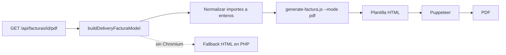

# I.4 — Integración legal y facturación electrónica (Sprint 4)

> **Alcance declarado:** el módulo es **pre-fiscal**. Controla timbrado, folios,
> IVA, numeración y auditoría, y emite un comprobante con CDC de control interno
> y QR verificable. La homologación SIFEN (XML firmado y autorización SET) se
> documenta como fase 2 en la sección 4.5.

## 4.1 Lógica fiscal y timbrado

### Modelo de datos

`timbrados` (migración 47):

| Campo | Tipo | Regla |
|---|---|---|
| `ruc`, `razon_social`, `direccion` | texto | Emisor del comprobante |
| `num_timbrado` | texto único | Número de timbrado de la SET |
| `establecimiento`, `punto_expedicion` | CHAR(3) | Forman el folio `EEE-PPP-NNNNNNN` |
| `fecha_inicio`, `fecha_fin` | DATE | Vigencia (`fecha_fin >= fecha_inicio`) |
| `nro_inicio`, `nro_fin` | INT | Rango autorizado (`nro_fin >= nro_inicio`) |
| `secuencia_actual` | INT | Último folio usado |
| `activo` | TINYINT | Habilitación manual |

`facturas`, `factura_items`, `factura_auditoria`: cabecera, detalle por concepto
y bitácora de emisión/anulación/reimpresión.

### Regla de bloqueo automático

Un timbrado es utilizable sólo si cumple **todas** las condiciones:

```sql
activo = 1
AND fecha_inicio <= CURDATE()
AND fecha_fin   >= CURDATE()
AND secuencia_actual < nro_fin
```

La emisión se ejecuta dentro de una transacción con `SELECT ... FOR UPDATE`, de
modo que dos emisiones concurrentes no consumen el mismo folio. Si no hay
timbrado válido, responde **422** y no crea factura ni consume secuencia.

### Alertas preventivas

`timbradoAlerta()` avisa cuando:

- quedan **menos de 15 días** de vigencia;
- quedan **menos de 50 folios** disponibles;
- no hay timbrado vigente (mensaje de bloqueo).

La UI (`TimbradosPage.jsx`) muestra el estado, la vigencia y los folios
restantes, y permite crear/editar timbrados con validaciones de formato (RUC
5–15 dígitos, timbrado 4–15 dígitos, rango coherente).

## 4.2 Cálculo fiscal (IVA incluido)

Los precios del servicio **ya incluyen IVA**. El impuesto se **extrae**, nunca
se suma encima:

```
IVA 10 % = round(bruto / 11)
IVA  5 % = round(bruto / 21)
gravada  = bruto − IVA
```

El resultado se redondea a **guaraníes enteros** (los comprobantes paraguayos no
llevan decimales).

### Ejemplos verificados

| Bruto | Tasa | IVA | Gravada | Suma |
|---|---|---|---|---|
| 7.000 | 10 % | 636 | 6.364 | 7.000 ✓ |
| 10.000 | 10 % | 909 | 9.091 | 10.000 ✓ |
| 1.050 | 5 % | 50 | 1.000 | 1.050 ✓ |
| 1.046.204 | 10 % | 95.109 | 951.095 | 1.046.204 ✓ |

### Invariantes del sistema

1. `gravada + IVA = total` en cada línea y en el resumen.
2. `SUBTOTAL + IVA − descuento = TOTAL A PAGAR`.
3. La liquidación del IVA muestra la misma cifra que el IVA del resumen.
4. El monto en letras corresponde al total exacto.

### Dónde se aplica

| Capa | Archivo | Función |
|---|---|---|
| Cálculo de emisión | `backend/src/services/facturacion_service.php` | `calcularIvaIncluido()` |
| Ventas | `backend/app/services/VentaService.php` | IVA por renglón |
| Compras | `backend/app/services/CompraService.php` | IVA por renglón y totales |
| Impresión de compras | `backend/app/controllers/CompraController.php` | Formato sin decimales |
| Payload KuDE/PDF | `backend/src/controllers/facturacion_controller.php` | `normalizarImportesFactura()` |
| Plantilla PDF | `factura-py/services/factura.template.js` | `formatearMoneda()` y `totalAPagar` |
| Flujo ventas | `factura-py/services/factura.mapper.js` | Normalización de resumen |

### Datos históricos

Las facturas emitidas antes del redondeo guardan decimales
(`951.094,55` / `95.109,45`). No se migran: la normalización se hace al generar
el comprobante, derivando la gravada del total y redondeando a enteros. La
factura **30001** se verificó contra el PDF real desplegado:

```
SUBTOTAL 951.095 · IVA 95.109 · TOTAL 1.046.204 · TOTAL IVA 95.109
SON: UN MILLÓN CUARENTA Y SEIS MIL DOSCIENTOS CUATRO GUARANÍES 00/100
```

## 4.3 Numeración, CDC y QR

### Folio correlativo

```
numero = sprintf('%03d-%03d-%07d', establecimiento, punto_expedicion, secuencia_actual + 1)
```

La secuencia se incrementa en la misma transacción que inserta la factura.
`UNIQUE(numero_completo)` evita duplicados y `UNIQUE(id_pedido)` garantiza una
factura por pedido (idempotencia).

### CDC de control interno

```
cdc = HMAC-SHA256(
  num_timbrado | numero | ruc_emisor | ruc_receptor |
  total | fecha_emision | id_pedido,
  clave = num_timbrado
)
```

Es un **hash de control interno de 64 hex**, no el CDC oficial de 44 dígitos
del SIFEN. Se muestra truncado en el KuDE y completo en el pie del PDF con la
leyenda "control interno".

### QR verificable

`qr_texto` guarda la **URL pública** del comprobante:

```
{APP_URL}/api/facturas/{id}/kude
```

Al escanearlo se abre el **PDF del comprobante**: el endpoint `/kude` entrega
`application/pdf` (mismo modelo y plantilla que la descarga autenticada). En el
PDF el QR se genera localmente con `qrcode` (data URI), sin depender de un
servicio externo. Con `?formato=html` se obtiene la misma factura en HTML, que
además sirve de respaldo si el servidor no puede generar el PDF.

### Pipeline KuDE / PDF



- **KuDE público:** `GET /api/facturas/{id}/kude` (sin token, es el destino del QR).
  Devuelve el PDF por defecto; `?formato=html` muestra la versión HTML.
- **HTML/PDF:** requieren sesión (`requireAuth`).
- **Resiliencia:** `domcontentloaded` + esperas acotadas (imágenes 4 s, fuentes
  2 s) + flags de Chromium; timeout de PDF 60 s. Si falla el motor, el HTML cae
  al fallback PHP y el PDF devuelve un mensaje claro.

## 4.4 Emisión, anulación y auditoría

### Flujo de emisión

1. Se valida el pedido (existe y no está cancelado).
2. Se bloquea y valida el timbrado.
3. Se calcula el IVA y la gravada.
4. Se inserta la factura y su ítem (con la **gravada** como precio/subtotal).
5. Se actualiza `qr_texto` con la URL pública.
6. Se registra `emitida` en `factura_auditoria`.
7. Se incrementa la secuencia y se confirma la transacción.

La emisión es **automática** al pasar el pedido a *Entregado* (mejor esfuerzo:
si no hay timbrado, la entrega no se rompe y se registra el error) y también
**manual** desde el panel.

### Anulación

`POST /api/facturas/{id}/anular` exige motivo, cambia `estado` a `Anulada`,
guarda `fecha_anulacion` y registra la acción en la auditoría. El folio **no se
reutiliza** (trazabilidad fiscal).

### Consulta y descargas

`GET /api/facturas` con filtros; `FacturasPage.jsx` permite ver el detalle,
abrir el KuDE, ver el HTML, descargar el PDF y anular con confirmación.

## 4.5 Brecha con SIFEN y plan de fase 2

### Implementado ✅

- Timbrado con vigencia, rango y bloqueo automático.
- Folio correlativo `EEE-PPP-NNNNNNN` con concurrencia segura.
- IVA 10 %/5 % extraído y redondeado a guaraníes enteros.
- Receptor con RUC/CI, razón social y dirección.
- KuDE/PDF con QR escaneable y CDC interno.
- Auditoría de emisión y anulación.
- Idempotencia por pedido y por `sync_uuid`.

### Pendiente para SIFEN real 🔴

| Requisito | Estado | Plan |
|---|---|---|
| XML `rDE` (DE) con namespace y schema SET | 🔴 | Generar desde el modelo de factura y validar contra XSD |
| Firma digital XML (certificado PFX) | 🔴 | Integrar firma XMLDSig con certificado del emisor |
| CDC oficial de 44 dígitos | 🔴 | Implementar algoritmo SET (tipo, RUC, establecimiento, punto, número, fecha, tipo contribuyente, DV) |
| Envío/recepción SOAP al SIFEN (test/producción) | 🔴 | Cliente SOAP + manejo de `rProtDe` y contingencia |
| KuDE con código de barras/QR oficial | 🟡 | El QR actual ya reabre el comprobante; adaptar al estándar |
| Eventos e inutilización de folios | 🔴 | Endpoints y XML de eventos |
| Contingencia offline fiscal | 🟡 | La cola existe; falta el modo contingencia declarado |

### Bosquejo de XML (propuesta, no implementado)

```xml
<rDE xmlns="http://ekuatia.set.gov.py/sifen/xsd">
  <dVerFor>150</dVerFor>
  <DE Id="CDC">
    <dDVId>0</dDVId>
    <dFecFirma>2026-10-29T10:00:00</dFecFirma>
    <dTipDE>1</dTipDE>
    <gEmis>
      <dRucEm>80012345</dRucEm>
      <dDVEmi>1</dDVEmi>
      <dNomEmi>GUSTAVO BENITEZ</dNomEmi>
      <gActEco><cActEco>49231</cActEco><dDesActEco>Transporte de carga</dDesActEco></gActEco>
    </gEmis>
    <gDatGralOpe>
      <dFeEmiDE>2026-10-29T10:00:00</dFeEmiDE>
      <gOpeCom><iTipTra>2</iTipTra><dDesTipTra>Contado</dDesTipTra></gOpeCom>
    </gDatGralOpe>
    <gDatRec>
      <iNatRec>1</iNatRec>
      <iTiOpe>1</iTiOpe>
      <dRucRec>1234567</dRucRec>
      <dNomRec>MARIA RODRIGUEZ</dNomRec>
    </gDatRec>
    <gDtipDE>
      <gCamFE><iIndPres>1</iIndPres></gCamFE>
      <gCamCond><iCondOpe>1</iCondOpe></gCamCond>
      <gCamItem>
        <dDesProSer>Servicio de reparto ecológico</dDesProSer>
        <dCantProSer>1</dCantProSer>
        <gValorItem>
          <dPUniProSer>951095</dPUniProSer>
          <dTotBruOpeItem>1046204</dTotBruOpeItem>
        </gValorItem>
        <gValorIVA>
          <iAfecIVA>1</iAfecIVA>
          <dTasaIVA>10</dTasaIVA>
          <dBasGravIVA>951095</dBasGravIVA>
          <dLiqIVAItem>95109</dLiqIVAItem>
        </gValorIVA>
      </gCamItem>
    </gDtipDE>
    <gTotSub>
      <dSubExe>0</dSubExe>
      <dSubGrav10>951095</dSubGrav10>
      <dIVA10>95109</dIVA10>
      <dTotGralOpe>1046204</dTotGralOpe>
    </gTotSub>
  </DE>
</rDE>
```

> El XML anterior es **ilustrativo** para mostrar el mapeo de datos; no se
> exporta ni se firma todavía. No debe presentarse como comprobante válido ante
> la SET.

## 4.6 Matriz de pruebas fiscales

| Caso | Entrada | Resultado esperado | Estado |
|---|---|---|---|
| Timbrado vencido | `fecha_fin` < hoy | 422, sin factura ni folio | ✅ |
| Folios agotados | `secuencia_actual = nro_fin` | 422, bloqueo | ✅ |
| Emisión normal | Pedido entregado, timbrado válido | Factura + folio + auditoría | ✅ |
| Idempotencia | Segundo POST del mismo pedido | `repetida: true`, sin duplicar | ✅ |
| IVA 10 % | Total 7.000 | 6.364 + 636 = 7.000 | ✅ |
| IVA 5 % | Total 1.050 | 1.000 + 50 = 1.050 | ✅ |
| Factura histórica | 1.046.204 con decimales guardados | 951.095 + 95.109 | ✅ |
| QR | Escanear el PDF | Abre el KuDE público | ✅ |
| Anulación | POST con motivo | Estado `Anulada` + auditoría | ✅ |
| PDF sin Chromium | Servidor sin navegador | 501 claro o fallback HTML | ✅ |
| Sesión vencida | Token con `exp` pasado | 401 y cierre de sesión | ✅ |
